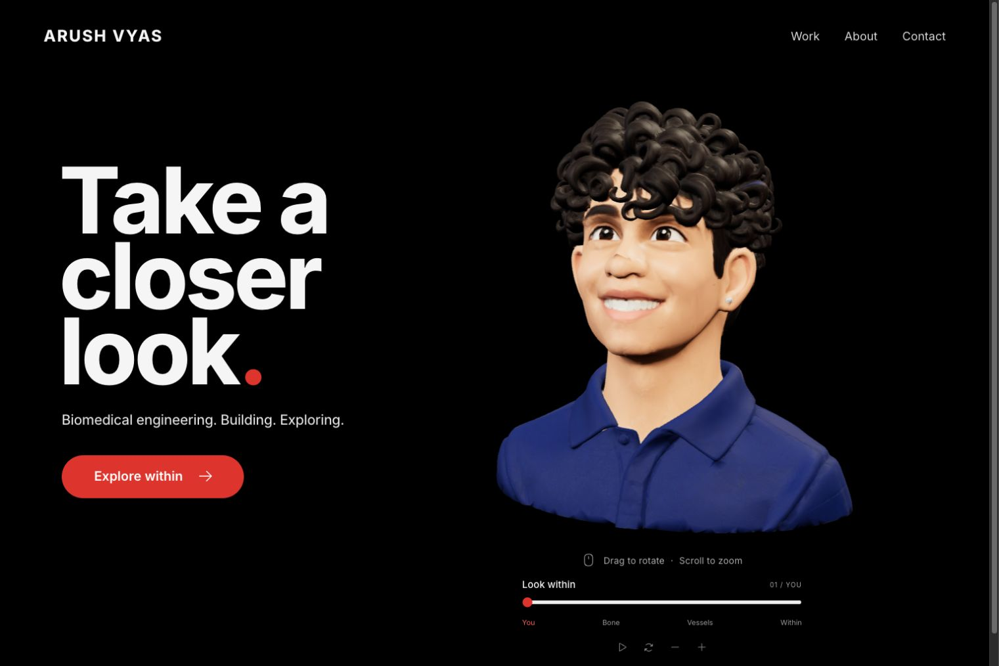

# Arush Vyas: A closer look

An interactive personal website built with React, Vite, and Three.js. A real, textured 3D avatar reveals an anatomical head and neck, introducing an atlas of research, Bay Area roots, making, desk setups, and story games.



## Run locally

Use Node.js 22.12 or newer. `.nvmrc` selects Node 22 for nvm users and CI.

```bash
git clone https://github.com/arushv1/personal-website.git
cd personal-website
npm ci
npm run dev
```

Open the local URL printed by Vite, usually http://localhost:5173. Changes in `src/` update the preview automatically. No API keys or backend services are required.

## Customize it

| What you want to change | Where to edit |
| --- | --- |
| Chapter titles, introductions, and stories | The `chapters` object in `src/App.jsx` |
| Homepage headline, navigation, contact information, profile links | `src/App.jsx` |
| Colors, typography, layout, and responsive behavior | `src/styles.css`; `:root` includes `--red` and `--muted` |
| Camera, orbit limits, lighting, materials, and reveal animation | `src/AnatomyScene.jsx` |
| Position of the interactive chapter markers | `anchors` in `src/AnatomyScene.jsx` |
| Resume PDF | Replace `public/arush-vyas-resume.pdf` |
| 3D models and avatar | `public/models/`; keep the attributions with the assets |
| Rebuild the avatar from its original textured GLB | `scripts/prepare-avatar.mjs` (`npm run prepare:avatar`) |
| Browser metadata | `index.html` and the document title in `src/App.jsx` |

To add a chapter, update `chapters` and `order` in `App.jsx`, then add its anchor and marker label in `AnatomyScene.jsx`. Keep chapter IDs consistent across those locations.

[AGENTS.md](AGENTS.md) contains the full project context, design rationale, architecture, verification procedure, and remaining work for future agents.

## Commands

```bash
npm run dev            # Local development with hot reload
npm run build          # Production client and optional Sites worker packaging
npm run test:sites     # Run after building: four worker / packaging contract tests
npm run preview        # Preview the production client
npm run prepare:models # Optional: rebuild the compressed anatomy assets
npm run prepare:avatar # Optional: rebuild the optimized textured avatar
```

The production frontend is in `dist/client/`. The build also emits `dist/server/index.js` and `dist/.openai/hosting.json` for a future Sites deployment. Build before running `test:sites`: its packaging check reads those generated files. The included GitHub Actions workflow runs these steps in that order; it does not deploy.

This replaces the previous Next.js implementation. `vercel.json` explicitly selects Vite, installs with `npm ci`, builds with `npm run build`, and serves `dist/client`. These values override the old framework and build/output settings in Vercel. The existing Git integration triggers a deployment when `main` changes; check its Vercel status separately from GitHub Actions. A successful GitHub build alone does not confirm publication.

## Experience

- Real 3D pointer orbit, wheel/pinch zoom, keyboard alternatives, zoom buttons, pause/play, and reset.
- The slider progresses through You, Bone, Vessels, and Within, with all layers sharing one rotatable 3D scene. Explore within opens five personal chapters.
- Work, About, Contact, resume, GitHub, LinkedIn, and email links.
- Responsive layouts, semantic controls, visible keyboard focus, and reduced-motion handling.

Copy is a draft grounded in Arush's supplied interests and resume. The avatar uses the supplied headshot as a likeness reference; exact desk hardware, personal stories, and detailed project case studies still need Arush's input.

## Anatomy and provenance

The outer avatar is an artistic likeness of Arush, generated and textured with Meshy 6 Lite and licensed CC BY 4.0. Its original textured GLB is retained in `source-assets/avatar/meshy-avatar-textured.glb`. The internal anatomy is generic, not a personal medical scan. Chapter locations are symbolic navigation, not statements about functional brain anatomy.

Bone and artery geometry comes from Z-Anatomy / BodyParts3D, through [nqwrc's web exports](https://github.com/nqwrc/3d-anatomy/tree/master/public/models). The cortex is directly sourced from [Brain for Blender by Anderson Winkler](https://brainder.org/research/brain-for-blender/), CC BY-SA 3.0.

The required attribution strings are:

- BodyParts3D - The Database Center for Life Science - CC-BY-SA 2.1 Japan
- Z-Anatomy - The open source atlas of anatomy - CC-BY-SA 4.0

Original notices, source links, modifications, and model-specific terms live in [public/models/ATTRIBUTION.md](public/models/ATTRIBUTION.md), `UPSTREAM-LICENSE.txt`, and `NOTICE.txt`. The site exposes them through Model credits. Model terms apply separately from the interface code.

Selected preprocessing inputs are retained in `source-assets/`, so `npm run prepare:models` works after installation without downloading data. The unused exploratory nervous-system export and duplicate archive are excluded. The application uses four optimized GLBs in `public/models/`, approximately 2.4 MB in total. The avatar preserves real geometry, UVs, and PBR textures; it does not use a photographic plane. Its original GLB is about 20 MB, while the web derivative is under 1 MB. The internal neck/upper-thorax geometry is registered to the cartoon bust’s shorter neck.

## Verification and design reference

[design-qa.md](design-qa.md) records the completed interaction and responsive checks. Screenshots are in `qa/`; the selected visual target is `reference/selected-option.png`.

The previous website remains available in Git history, including commit `7d7557c`.
